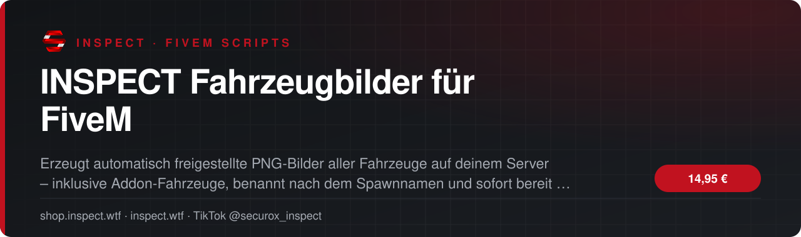
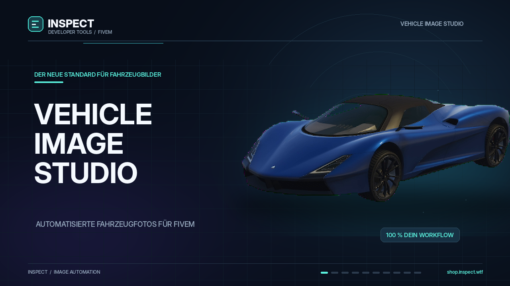

<!-- inspect-showcase: automatisch erzeugt, Änderungen bitte im Shop vornehmen -->

  
  
  
  
  

  
  
  

 

 

## Das Wichtigste auf einen Blick

<table>
  <tr>
    <td width="50%" valign="top">✔&nbsp; <b>Erkennt automatisch alle Fahrzeuge auf dem Server, inklusive Addon-Fahrzeuge</b></td>
    <td width="50%" valign="top">✔&nbsp; <b>Erzeugt nur fehlende Bilder – vorhandene Dateien werden übersprungen</b></td>
  </tr>
  <tr>
    <td width="50%" valign="top">✔&nbsp; <b>Option zum vollständigen Neuerzeugen aller Bilder</b></td>
    <td width="50%" valign="top">✔&nbsp; <b>PNG mit transparentem Hintergrund</b></td>
  </tr>
</table>

## Überblick

INSPECT Fahrzeugbilder erstellt vollautomatisch einheitliche Vorschaubilder für alle Fahrzeuge auf deinem FiveM-Server. Das Script erkennt selbstständig jedes verfügbare Fahrzeug, auch alle Addon-Fahrzeuge, und fotografiert nur die Modelle, für die noch kein Bild im Zielordner liegt. Jedes Fahrzeug wird sauber, unbeschädigt und aus demselben Blickwinkel vor einem Studio-Hintergrund aufgenommen, automatisch freigestellt und als PNG mit transparentem Hintergrund gespeichert. Der Dateiname entspricht dem Spawnnamen, zum Beispiel adder.png, sodass die Bilder direkt in Garagen-, Autohaus-, Tuning- oder Inventar-Scripts verwendet werden können. Kommen neue Fahrzeuge auf den Server, genügt ein erneuter Start: Vorhandene Bilder bleiben erhalten, nur die neuen werden ergänzt. Die Aufnahme erfolgt über einen eigenen Zugriff auf das Spielbild, daher wird weder screenshot-basic noch screencapture benötigt. Bildgröße, Rand, Kamerawinkel, Kennzeichentext, Zielordner sowie ausgeschlossene Fahrzeugklassen und Modelle lassen sich bequem in der Konfiguration einstellen. Das Script ist framework-unabhängig, benötigt keine Datenbank und ist nur während der Bilderzeugung aktiv.

## Kompatibilität

| | |
|:--|:--|
| Frameworks | **ESX** · **QBCore** · **Qbox** · **Standalone** |
| Plattform | FiveM (GTA V) |

## Alle weiteren Funktionen

- Dateiname entspricht dem Spawnnamen (z. B. adder.png)
- Automatische Freistellung mit sauberer Kantenglättung
- Einheitlicher Look: gleicher Blickwinkel, sauber, unbeschädigt, Licht aus
- Eigener Kennzeichentext für alle Aufnahmen
- Bildgröße und Rand frei einstellbar (Standard 640×360)
- Kamerawinkel und Sichtfeld anpassbar
- Zielordner frei wählbar – auch direkt im Bilderordner von Garage, Autohaus oder Tuning
- Fahrzeugklassen ausschließbar (z. B. Züge, Boote, Helikopter, Flugzeuge)
- Ausschlussliste für einzelne Fahrzeuge
- Fahrwerk bei Flugzeugen und Helikoptern wird automatisch eingefahren

<b>11 weitere Funktionen anzeigen</b>

- Zweiter Ladeversuch mit längerer Wartezeit für große Addon-Fahrzeuge
- Kein screenshot-basic oder screencapture nötig – eigene Spielbild-Aufnahme
- Fortschrittsanzeige im Spiel, Abbruch jederzeit per Rücktaste
- Start bequem über die Server-Konsole oder die txAdmin Live Console
- Absicherung per ACE-Berechtigung
- Server nimmt Bilder nur vom startenden Admin an und prüft jede Datei vor dem Speichern
- Abschlussbericht in der Server-Konsole mit Liste der Fahrzeuge ohne Bild
- Framework-unabhängig: ESX, QBCore, Qbox oder Standalone
- Keine Datenbank erforderlich
- Keine Last im Normalbetrieb: nur während der Bilderzeugung aktiv
- Offener, unverschlüsselter Quellcode – frei anpassbar

## Preis

**14,95 €** &nbsp;–&nbsp; einmaliger Kaufpreis · Download und Lizenz im Kundenkonto

Sichere Zahlung mit PayPal oder Kreditkarte · Rechnung als PDF · Support auf Deutsch

## So einfach geht's

1. **Im Shop kaufen** – sicher bezahlen mit PayPal oder Kreditkarte.
2. **Sofort loslegen** – Download und Lizenz stehen direkt nach Zahlungseingang in deinem Kundenkonto bereit, die Rechnung erhältst du als PDF.
3. **Einrichten** – bei Fragen hilft dir unser Support im Discord weiter.

## Warum INSPECT?

<table>
  <tr>
    <td width="50%" valign="top"><b>🇩🇪 Entwickelt in Deutschland</b> Konzeption, Entwicklung und Support aus einer Hand.</td>
    <td width="50%" valign="top"><b>💬 Persönlicher Support</b> Schnelle Hilfe auf Deutsch im INSPECT Discord.</td>
  </tr>
  <tr>
    <td width="50%" valign="top"><b>🔒 Sichere Zahlung</b> PayPal oder Kreditkarte, Rechnung automatisch als PDF.</td>
    <td width="50%" valign="top"><b>⚡ Sofort verfügbar</b> Download und Lizenz direkt nach der Zahlung im Kundenkonto.</td>
  </tr>
</table>

## Häufige Fragen

<b>Wie erhalte ich das Produkt?</b>

 

Nach bestätigter Zahlung stehen Download und Lizenz in deinem Kundenkonto bereit. Die Rechnung erhältst du als PDF.

<b>Welche Frameworks werden unterstützt?</b>

 

ESX, QBCore, Qbox, Standalone.

<b>Bekomme ich Hilfe bei der Einrichtung?</b>

 

Ja – unser Support hilft dir im [INSPECT Discord](https://discord.gg/inspect) persönlich und auf Deutsch.

<b>Wo kaufe ich offiziell?</b>

 

Ausschließlich im INSPECT Shop unter [shop.inspect.wtf](https://shop.inspect.wtf). Angebote von Dritten stammen nicht von uns.

## Kontakt

| | |
|:--|:--|
| 🛒 Shop | [shop.inspect.wtf](https://shop.inspect.wtf) |
| 🌐 Website | [inspect.wtf](https://inspect.wtf) |
| 💬 Discord | [discord.gg/inspect](https://discord.gg/inspect) |
| 🎬 TikTok | [@securox_inspect](https://www.tiktok.com/@securox_inspect) |
| ✉️ E-Mail | [info@inspect.wtf](mailto:info@inspect.wtf) |

---

<b>SecuroX Inspect</b> · Offizielle Produktpräsentation · Dieses Repository enthält keinen Quellcode und keine Produktdateien. 
Kauf und Lizenzen ausschließlich über <a href="https://shop.inspect.wtf">shop.inspect.wtf</a> · Inhalte werden automatisch aus dem Shop aktualisiert.

